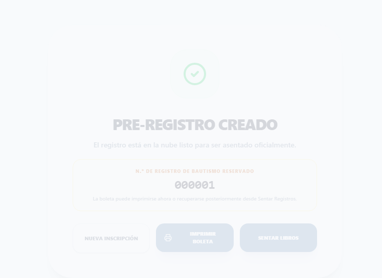
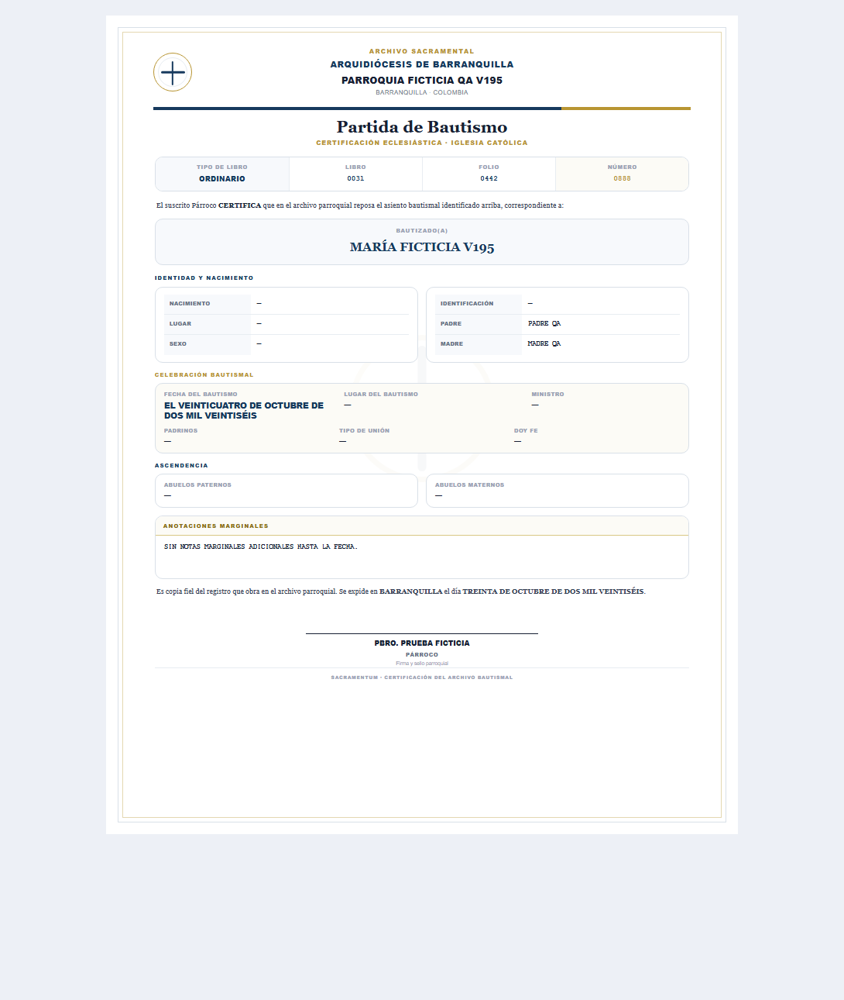
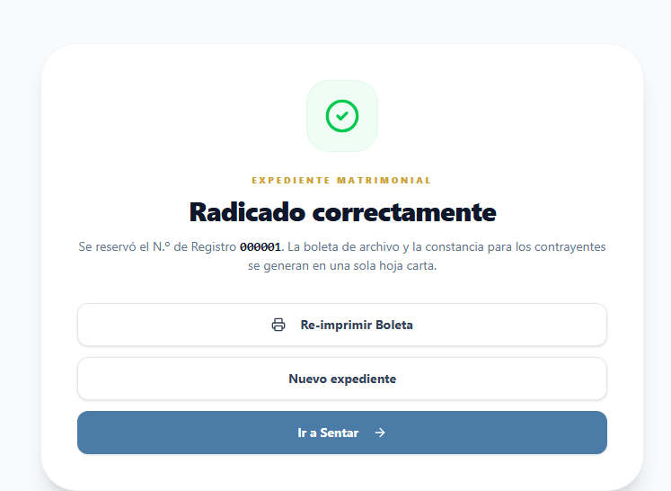
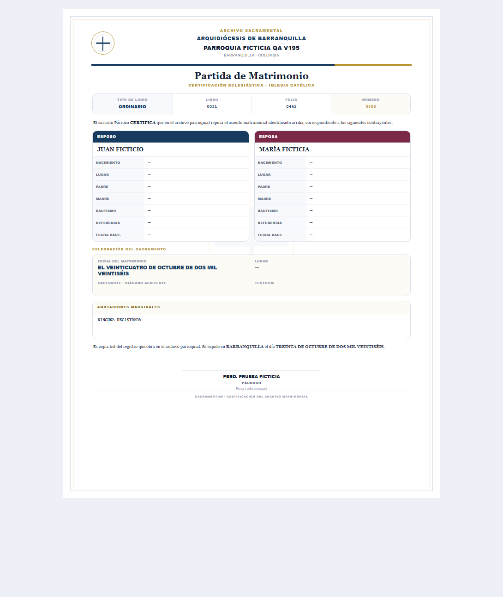

# SACRAMENTUM — EXPEDIENTE VISUAL DE ENSAYOS V322

> **PRUEBA FICTICIA / SIN VALIDEZ SACRAMENTAL NI JURÍDICA.** Este expediente se creó exclusivamente para revisar el diseño y los contratos técnicos de SACRAMENTUM. Ninguno de los nombres, números de asiento, firmas, parroquias ni documentos de estas muestras constituye un acto de registro real. Los escenarios SQL ejecutados en Supabase terminan en `ROLLBACK` y no persisten la prueba.

## 1. Cuatro sacramentos: boleta → partida → libro e índice

| Sacramento | Captura boleta (interfaz React real con datos simulados) | Captura partida (plantilla React real) | PDF libro | PDF índice |
|---|---|---|---|---|
| **Bautismo** | [Abrir](BOLETAS/boleta-react-bautismo-v322.png) | [Carta](PARTIDAS/v195-bautismo-letter.png) · [Móvil](PARTIDAS/v195-bautismo-mobile.png) | [Libro](LIBROS/libros-bautismo-v322.pdf) | [Índice](INDICES/indices-bautismo-v322.pdf) |
| **Confirmación** | [Abrir](BOLETAS/boleta-react-confirmacion-v322.png) | [Carta](PARTIDAS/v195-confirmacion-letter.png) · [Móvil](PARTIDAS/v195-confirmacion-mobile.png) | [Libro](LIBROS/libros-confirmacion-v322.pdf) | [Índice](INDICES/indices-confirmacion-v322.pdf) |
| **Matrimonio** | [Abrir](BOLETAS/boleta-react-matrimonio-v322.png) | [Carta](PARTIDAS/v195-matrimonio-letter.png) · [Móvil](PARTIDAS/v195-matrimonio-mobile.png) | [Libro](LIBROS/libros-matrimonio-v322.pdf) | [Índice](INDICES/indices-matrimonio-v322.pdf) |
| **Exequias** | [Abrir](BOLETAS/boleta-react-exequias-v322.png) | [Carta](PARTIDAS/v195-exequias-letter.png) · [Móvil](PARTIDAS/v195-exequias-mobile.png) | [Libro](LIBROS/libros-exequias-v322.pdf) | [Índice](INDICES/indices-exequias-v322.pdf) |

Las capturas de **boleta** muestran páginas de registro de la aplicación React, con servicios simulados y sin datos persistidos. Las capturas de **partidas** se obtuvieron de los componentes React de impresión. Los **libros e índices** se generaron con `src/services/sacramentalBookPdf.js` y datos completamente ficticios. No se realizó impresión física.

### Comparación visual rápida

**Bautismo:** boleta

**Bautismo:** partida en tamaño carta

**Matrimonio:** boleta

**Matrimonio:** partida en tamaño carta

## 2. Decretos imprimibles (generador real)

| Clase de documento | Evidencia PDF | Plantilla HTML |
|---|---|---|
| **Corrección**: cotejo de partida original y datos corregidos / supletoria | [Ver decreto](DECRETOS/decreto-correccion-v322.pdf) | [HTML](DECRETOS/decreto-correccion-v322.html) |
| **Reposición**: partida supletoria, fundamento y prueba | [Ver decreto](DECRETOS/decreto-reposicion-v322.pdf) | [HTML](DECRETOS/decreto-reposicion-v322.html) |
| **Repetición**: tres parroquias, conservar una partida y dejar dos sin efectos documentales | [Ver decreto](DECRETOS/decreto-repeticion-v322.pdf) | [HTML](DECRETOS/decreto-repeticion-v322.html) |
| **Decreto documental** sin modificación automática de partida | [Ver decreto](DECRETOS/decreto-documental-v322.pdf) | [HTML](DECRETOS/decreto-documental-v322.html) |
| **Reconstrucción histórica** sin simular emisión nueva | [Ver decreto](DECRETOS/decreto-historico-v322.pdf) | [HTML](DECRETOS/decreto-historico-v322.html) |

Estos cinco archivos se generaron mediante `src/services/decreeDocumentHtml.js`; los documentos contienen datos ficticios y una indicación de ensayo. El **proceso de nulidad matrimonial** se verificó en SQL con control judicial y doble autorización; **no se creó una supuesta sentencia ni un decreto judicial PDF**, porque no sería un documento expedido por autoridad competente.

## 3. Avisos, notificaciones y privacidad

| Bandeja React probada | Captura |
|---|---|
| Aviso sacramental de la parroquia destinataria B | [Ver](NOTIFICACIONES/aviso-sacramental-parroquia-b-v322.png) |
| Decreto recibido, visible únicamente en la parroquia B | [Ver](NOTIFICACIONES/notificacion-decreto-parroquia-b-v322.png) |
| Confirmación originada en parroquia B para emitir notificación | [Ver](NOTIFICACIONES/origen-confirmacion-parroquia-b-v322.png) |

Los ensayos SQL V319 incluyen notificación matrimonial con **dos destinatarios**, bloqueo de duplicados, notas marginales, repetición de Bautismo con **tres parroquias y una jurisdicción externa**, constancia documental e impedimento de cierre prematuro. V320 demuestra separación de **Cancillería, Diócesis y parroquias**. Estos flujos se verificaron con transacciones reversibles.

## 4. Comprobantes técnicos auditables

- [21 escenarios de creación de boleta en navegador React](capturas-boletas-v322.json) — **21/21** después de ampliar la espera inicial de carga; sin solicitudes externas ni errores JavaScript.
- [Ocho vistas de partidas](capturas-partidas-v322.json) — **8/8** plantillas correctas (cuatro sacramentos × carta/móvil).
- [Resultados SQL, bloque 1](sql-bloque1.json) — **8/8**.
- [Resultados SQL, bloque 2](sql-bloque2.json) — **8/8**.
- [Resultados SQL, bloque 3](sql-bloque3.json) — **5/9** al ejecutarse directamente: cinco pasan y cuatro pruebas históricas precisan ajuste de fixture o contrato.
- [Pruebas visuales de notificaciones](capturas-notificaciones-v322.json).
- [Metadatos de los PDF](manifest-ejemplos.json).

**Resumen SQL:** 21 de 25 guiones ejecutados con éxito directo. Se registraron cuatro incompatibilidades históricas, no equivalentes automáticamente a fallas actuales:
1. `qa-rollback-documentary-decree-lifecycle-v210.sql`: sin cuentas parroquiales independientes coherentes en la instancia de QA; necesita fixtures reversibles como en auditoría V319.
2. `qa-rollback-marginal-four-sacraments-v216.sql`: no encuentra el ámbito diocesano requerido; es un problema de precondiciones de fixture.
3. `qa-rollback-registry-print-integrity-v140.sql`: usa un recibo sin el cotejo y huella de partida **obligatorios desde V194**.
4. `qa-rollback-print-receipt-authenticated-v142.sql`: mismo contrato de impresión V194, antes de la migración.

La prueba **vigente** `qa-rollback-print-integrity-v194.sql` sí aprobó **4/4** documentos, **4** notas obligatorias conservadas y **20** solicitudes indebidas rechazadas. No se debilitó ninguna exigencia de huella para hacer pasar los guiones antiguos.

## 5. Alcance y límites

**Probado:** generación visual de pantallas y plantillas reales con datos aislados; consecutivos de ocho boletas; cuatro asientos y bloqueos de duplicación; integridad de impresión V194; correcciones, reposiciones, historización, repetición, nulidad con autorización, notificaciones y privacidad según los guiones referenciados.

**No certificado:** firma física de Cancillería, entrega externa real de notificaciones, múltiples cuentas parroquiales oficiales simultáneas en el navegador real, impresión con impresora física, ni habilitación del libro-folio-número oficial en una base recién puesta en cero. La apertura oficial sigue condicionada a la limpieza respaldada V268, revisión V273 y puesta en marcha V267.

**Las evidencias son deliberadamente simuladas para no contaminar el archivo sacramental de prueba/producción ni generar actos falsos.**
